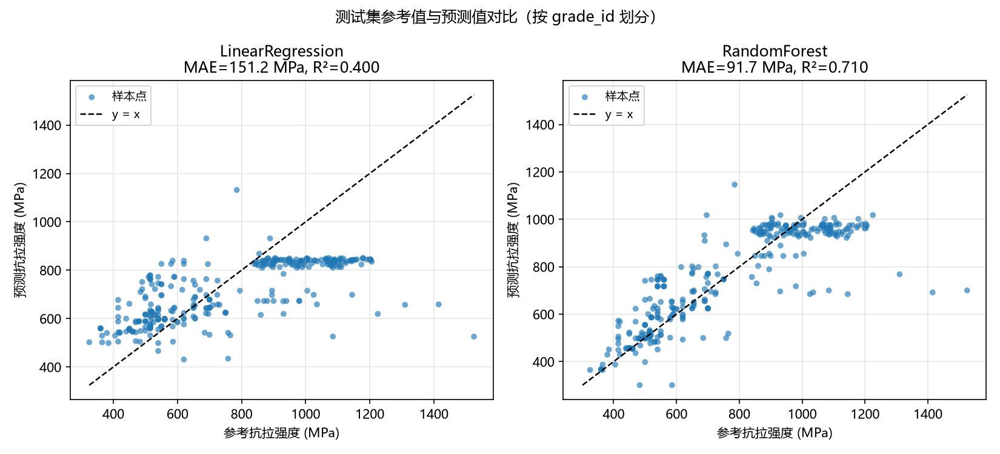
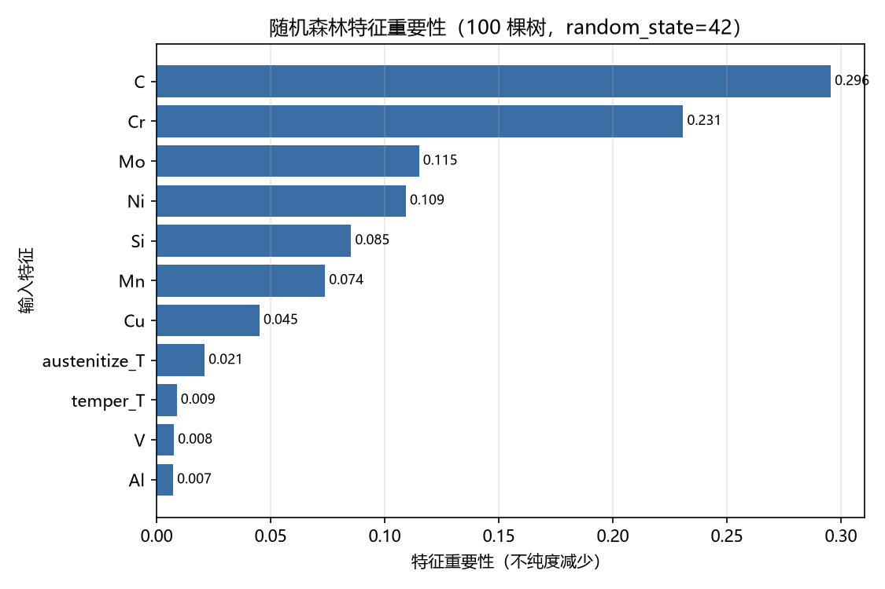

# 合金钢抗拉强度预测（SteelBench v1.0 公开子集）

用钢的化学成分与热处理工艺参数，预测抗拉强度 UTS（MPa），并比较**多元线性回归**与**随机森林**在"按钢种划分"测试集上的表现。全部指标由本项目脚本实际运行得到，未做任何人工调整。

- GitHub 仓库：<https://github.com/ACAD-f/AI>
- 本项目目录：仓库内的 `steel-strength-prediction/`（仓库根目录另有其他课程作业，本目录可独立运行）
- 运行入口：在 `steel-strength-prediction/` 目录内执行 `python steel_regression.py`

## 一、数据来源与许可

| 项目 | 内容 |
| --- | --- |
| 数据集 | SteelBench v1.0 — A Benchmark Dataset for Steel Mechanical Property Prediction with Grade-Shift Evaluation |
| 公开子集文件 | `data/steelbench_core_open.csv`（1,360 行 × 25 列） |
| 作者 / 维护方 | Volkov, Alexander；Kozhukhov, Alexey；Sultimov, Roman；Malykh, Maxim；Maximov, Yury（SteelBench 团队） |
| 版本 / 日期 | v1.0，2026-02-02 |
| DOI | [10.5281/zenodo.18530558](https://doi.org/10.5281/zenodo.18530558) |
| 来源 | Zenodo 记录 <https://zenodo.org/records/18530558>；参考代码 <https://github.com/cornada/steelbench> |
| 许可 | **CC-BY 4.0**（见 `data/LICENSE`），使用时须署名、给出许可链接并说明是否修改 |
| 原始数据是否修改 | **否**。`data/` 下三个文件与 Zenodo 原件逐字节一致（MD5 核对见下），程序只读取，不补造、不覆盖 |

Zenodo 公布的 MD5 与本地文件核对（2026-11-22 下载后校验）：

| 文件 | 大小 (byte) | MD5（Zenodo = 本地） | 一致 |
| --- | ---: | --- | :---: |
| `steelbench_core_open.csv` | 197,198 | `ca0e58deadd2900ab7a3f96a25d5b0d2` | ✅ |
| `DATASET_CARD.md` | 4,423 | `ab298c45d9557d2a6546c709aa197336` | ✅ |
| `LICENSE` | 1,428 | `9e9aa90818565e748d1393ee17908853` | ✅ |

数据由三个来源层级（`data_tier`）汇总而成：

| data_tier | 记录数 | 含义 | 原始许可 |
| --- | ---: | --- | --- |
| `emk_spec_verified` | 753 | EMK 手册的**技术规范最低强度**（不是实测值） | 公有领域 |
| `nims_measured` | 360 | 日本 NIMS 实验室**实测**数据 | 公有领域 |
| `kaggle_measured` | 247 | Kaggle 数据集**实测**值 | CC-BY / 公有领域 |

> ⚠️ `emk_spec_verified` 是规范要求的下限值，与另外两层的实测值含义不同，二者**不能混为一谈**。本仓库在结果中始终按 `data_tier` 分层报告，不做合并解释。

推荐引用（以 Zenodo 记录为准）：

> Volkov, A., Kozhukhov, A., Sultimov, R., Malykh, M., & Maximov, Y. (2026).
> *SteelBench v1.0: A Benchmark Dataset for Steel Mechanical Property Prediction with Grade-Shift Evaluation* [Data set].
> Zenodo. <https://doi.org/10.5281/zenodo.18530558>

`data/DATASET_CARD.md` 另附会议论文引用（KDD 2026，作者署名暂为 Anonymous，原样保留未改动）：

```bibtex
@inproceedings{steelbench2026,
  title={SteelBench: Predicting Steel Properties under Real-World Data Gaps, Specification Ranges, and Grade Shift},
  author={Anonymous},
  booktitle={KDD},
  year={2026}
}
```

## 二、输入与输出

**输入特征（11 个）**

| 特征 | 含义 | 单位 |
| --- | --- | --- |
| `C`、`Mn`、`Si`、`Cr`、`Ni`、`Mo`、`V`、`Cu`、`Al` | 合金元素质量分数 | wt.% |
| `austenitize_T` | 奥氏体化温度 | °C |
| `temper_T` | 回火温度 | °C |

**预测目标**：`tensile_strength`（抗拉强度，MPa）。

**禁止作为输入的列**：屈服强度、延伸率、断面收缩率、冲击功、硬度等其他力学性能（与目标同源，属于标签泄漏），以及 `grade_id`、`source`、`data_tier`、`split` 等标识或来源列。

**输出文件（`results/`）**

| 文件 | 内容 |
| --- | --- |
| `metrics.csv` | 两个模型在全部测试集及各 `data_tier` 子集上的样本数、MAE、RMSE、R² |
| `predictions.csv` | 测试集逐样本的编号、钢种、来源层级、参考强度与两个模型的预测强度 |
| `prediction_comparison.png` | 参考值-预测值散点图（含 y = x 参考线） |
| `feature_importance.png` | 随机森林特征重要性 |

## 三、运行方法

```bash
# 1. 进入本项目目录（仓库根下的 steel-strength-prediction/）
cd steel-strength-prediction

# 2. 安装依赖（虚拟环境放在仓库外，本目录不提交 .venv）
python -m pip install -r requirements.txt

# 3. 在本目录运行（脚本使用相对路径 data/ 与 results/，勿在 results/ 或 data/ 内运行）
python steel_regression.py
```

本次实际运行复用了课程上一实验已建好的虚拟环境（不新建环境、不提交 `.venv`），解释器为该环境下的 `Scripts\python.exe`（Python 3.12.14）；已安装 scikit-learn 1.9.1、pandas 3.1.1、numpy 2.5.5、matplotlib 3.11.2（Windows 11），`requirements.txt` 固定了这四个包的版本。

程序运行后会生成/覆盖 `results/` 下的 4 个文件；仓库中提交的结果就是该环境实际运行的输出。

## 四、数据检查与划分

- 原始数据 1,360 条、25 个字段、562 个钢种；`data_tier` 分布 753 / 360 / 247。
- 清洗项：目标值缺失或 ≤ 0 的记录 0 条、`grade_id` 缺失 0 条、完全重复 0 条 ⇒ 清洗后仍为 **1,360 条 / 562 个钢种**（数据本身较干净，脚本仍保留这三步检查以防换数据后失效）。
- 输入特征缺失率：`temper_T` 71.5%、`Al` 57.6%、`austenitize_T` 49.4%、`Cu` 42.5%、`Mo` 29.1%、`Ni` 19.0%、`Si` 14.0%、`Cr` 13.3%，`C`、`Mn`、`V` 无缺失。
- **划分方式**：`GroupShuffleSplit`，按 `grade_id` 分组，`test_size=0.2`，`random_state=42`。结果：训练集 1,046 条 / 449 个钢种，测试集 314 条 / 113 个钢种，两组钢种重叠数为 **0**。同一钢种的多条记录只会落在同一侧，避免"同钢种不同工艺"跨集泄漏。
- 缺失值处理：`SimpleImputer(strategy="median", add_indicator=True)` 放在 `Pipeline` 内，**只用训练集拟合**；未知成分/温度用中位数填补并额外生成"是否缺失"指示列，**不填成 0**（0 wt.% 是有物理含义的成分值）。训练集中整列完全缺失的特征会被报告并排除，本次无此情况。

> 说明：本次按 `grade_id` 重新划分，**不等于官方基准测试**。数据集自带的 `split` 列在公开子集中只有一个取值 `pretrain`，无法直接当作官方训练/测试划分使用；与 SteelBench 论文中的 GKF-grade 五折协议也不完全相同。

## 五、模型与测试集结果

| 模型 | 参数 |
| --- | --- |
| 多元线性回归 | `LinearRegression()`（默认参数） |
| 随机森林 | `RandomForestRegressor(n_estimators=100, random_state=42)` |

两个模型共用同一划分、同一 `Pipeline`，只在训练集上 `fit`，测试集不参与任何调参。

**全部测试集（n = 314）**

| 模型 | MAE (MPa) | RMSE (MPa) | R² |
| --- | ---: | ---: | ---: |
| 多元线性回归 | 151.20 | 194.06 | 0.4003 |
| 随机森林 | **91.74** | **135.02** | **0.7097** |

**分 data_tier 结果**

| data_tier | n | 线性回归 MAE | 线性回归 RMSE | 线性回归 R² | 随机森林 MAE | 随机森林 RMSE | 随机森林 R² |
| --- | ---: | ---: | ---: | ---: | ---: | ---: | ---: |
| `emk_spec_verified` | 137 | 118.42 | 143.82 | −0.1719 | 66.94 | 97.36 | 0.4629 |
| `nims_measured` | 117 | 177.44 | 204.03 | −2.9821 | 95.51 | 114.67 | −0.2580 |
| `kaggle_measured` | 60 | 174.85 | 262.09 | −0.0515 | 141.02 | 219.36 | 0.2634 |

参考强度范围 325–1,525 MPa。随机森林有 66.9% 的测试样本绝对误差在 ±100 MPa 以内（线性回归 40.1%），±200 MPa 以内分别为 88.5% 和 70.4%。





## 六、结果讨论

**1. 哪个模型误差更小？**
随机森林明显更好：MAE 91.74 MPa，比线性回归（151.20 MPa）低约 39%；RMSE 135.02 MPa 对 194.06 MPa；整体 R² 0.7097 对 0.4003。线性回归的预测被"压缩"在 431–1,131 MPa 的窄带内，对高强度钢系统性低估——成分与强度之间并非线性关系，碳当量、铬当量、碳化物析出等效应带明显交互与阈值，树模型能捕捉这些非线性分段。但两个模型都在 1,200 MPa 以上的高强样本上严重低估（最差样本参考 1,525 MPa、预测 700 MPa），说明树模型不能外推到训练分布之外。

**2. 成分和工艺信息如何用于预测？**
特征重要性以 C（0.296）和 Cr（0.231）为主，其次是 Mo（0.115）、Ni（0.109）、Si（0.085）、Mn（0.074）。这与冶金常识一致：碳是固溶强化与马氏体硬度的首要因素，铬、钼、镍通过固溶、碳化物析出与淬透性影响强度。工艺温度的重要性则低得多（`austenitize_T` 0.021、`temper_T` 0.009），主要原因是它们缺失严重（49.4% / 71.5%），中位数填补后大部分样本取值相同，模型难以从中获得区分度；同时公开数据只给出温度、不含保温时间与冷速，工艺信息本身不完整。

**3. 缺失工艺与混合来源数据有什么局限？**
- 分层误差差异极大：随机森林在 `emk_spec_verified` 层 R² 为 0.463、`kaggle_measured` 层为 0.263，但在 `nims_measured` 层降到 −0.258；线性回归在三个分层内 R² 全为负（−0.172、−2.982、−0.052），即分层后还不如直接用该层均值预测。三层数据的强度均值分别为 612、666、908 MPa，差距很大，这意味着"整体 R²"有相当部分来自层级之间的均值差异，而不是同一层级内部的排序能力。把规范最低值与实测值混在一起，会让指标看起来比实际可用性好。
- 缺失值填补引入偏差：`temper_T` 缺失 71.5%，中位数填补相当于假设"缺失样本都按中位温度回火"，会削弱甚至扭曲温度效应；`Al`、`Cu` 等微量元素缺失率超过 40%，其重要性估计同样不可靠。
- 样本不均衡：562 个钢种平均每钢种 2.42 条记录，最多一个钢种有 159 条，按钢种分组后测试集只覆盖 113 个钢种，指标对具体划分敏感。

**4. 特征重要性不等于因果关系。**
随机森林的"不纯度减少"重要性只表示该特征在树分裂中对降低训练误差的贡献，受缺失率、量纲、特征间共线性（如 Cr 与 Ni、Mo 在合金钢中常同向变化）以及训练分布影响。它不能说明"提高碳含量必然提高强度"这类因果结论，也不能外推到数据未覆盖的成分-工艺区间；若要讨论因果，需要控制变量实验或因果推断方法，而不能依赖模型的重要性排序。

## 七、项目结构

```
AI/                                # GitHub 仓库 ACAD-f/AI
├── README.md、rag/、output/ …      # 仓库内其他课程作业（与本项目无关）
└── steel-strength-prediction/     # 本项目
    ├── data/
    │   ├── steelbench_core_open.csv   # 原始数据（未修改）
    │   ├── DATASET_CARD.md            # 官方数据说明
    │   └── LICENSE                    # CC-BY 4.0
    ├── results/
    │   ├── metrics.csv
    │   ├── predictions.csv
    │   ├── prediction_comparison.png
    │   └── feature_importance.png
    ├── steel_regression.py            # 主程序（含完整中文注释）
    ├── requirements.txt
    ├── .gitignore
    └── README.md
```

## 八、局限与可改进方向

1. 只用了单次 80/20 划分，未做交叉验证，指标对划分随机性敏感；可补充按 `grade_id` 分组的 5 折交叉验证（与官方 GKF-grade 协议对齐）。
2. 中位数填补无法表达"未知"的真实含义；可尝试树模型原生缺失分裂（HistGradientBoosting）或把缺失作为独立类别建模。
3. 未区分 `data_tier` 建模；可分层建模或引入来源指示特征，并单独报告实测层的性能。
4. 缺少保温时间、冷却速率、晶粒度等工艺与组织信息，是精度提升的主要瓶颈。
5. 高强钢（>1,200 MPa）样本稀少且外推失败，实际使用时应限定在训练分布覆盖的强度区间。

## 九、许可与致谢

数据版权归 SteelBench 团队（Volkov 等）所有，按 **CC-BY 4.0** 使用；本仓库代码仅用于课程学习。若转载数据，请保留 `data/LICENSE` 并注明作者、DOI 与来源链接。

## 十、版本记录

| 提交摘要 | 内容 |
| --- | --- |
| `V1.0 - 回归程序初始版本` | 首次提交：原始数据、`steel_regression.py`、README、requirements.txt 及 `results/` 中实际运行得到的结果 |
| `V1.1 - 添加完整中文注释` | 仅为 `steel_regression.py` 增加中文注释（研究目标、变量与单位、清洗、划分、算法、评价指标、输出文件），计算逻辑、参数与结果均不变；重跑后 4 个结果文件逐字节一致 |
